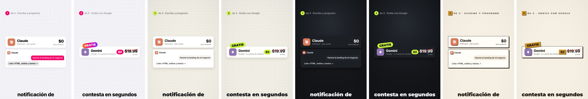
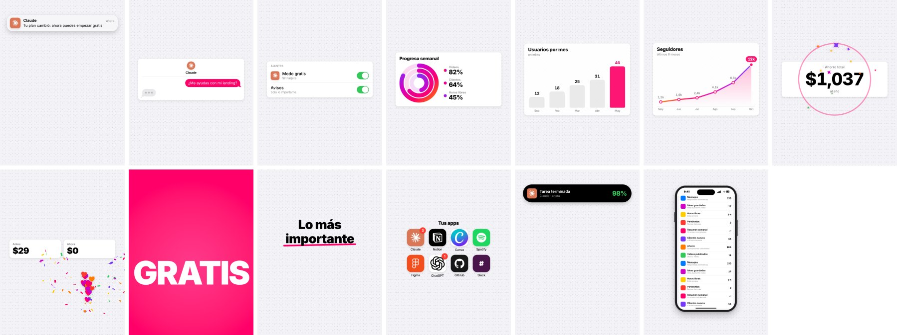

# Editor de YouTube Shorts

Le pasas un video tuyo hablando a cámara a Claude y te devuelve un Short editado al nivel de los creadores de IA. El editor:
- quita pausas y muletillas;
- pone subtítulos palabra por palabra con las palabras clave en color;
- te recorta **con borde blanco** sobre un fondo estilo iOS con puntitos que se mueven;
- agrega tarjetas animadas con **logos** de cada herramienta que mencionas, con precios que se tachan, repos de GitHub, terminal y chat;
- suma **motion graphics** estilo iOS e Instagram: notificaciones, iMessage con «escribiendo…», interruptores, anillos, gráficas, odómetro de precios, corazones, confeti y la «palabra golpe»;
- pone un gancho al inicio, secciones numeradas y el «Comenta PALABRA» del final;
- suma efectos de sonido y deja el audio a -14 LUFS.

## Cómo se usa (con Claude)

1. Abre este repo en Claude Code: terminal, app de escritorio o claude.ai/code.
2. Pon tu video en la carpeta (por ejemplo `videos/mi-video.mp4`) y dile a Claude: **«edita este video como short»**.
3. Claude sigue la skill [`editar-short`](.claude/skills/editar-short/SKILL.md):
   - transcribe y corta;
   - lee lo que dijiste y arma el storyboard (qué tarjeta y qué logo en cada palabra);
   - revisa cuadros sueltos;
   - renderiza y revisa la hoja de contactos;
   - te entrega el MP4.

Puedes pedirle cambios en lenguaje normal: «usa el tema oscuro», «más tarjetas», «más motion graphics», «que la palabra del final sea GUÍA», «saca la parte donde me equivoqué».

## Instalación

Necesitas **Python 3.10–3.13** y **ffmpeg**.

**1. ffmpeg** (uno de estos, según tu sistema):

```bash
brew install ffmpeg
```

```bash
winget install Gyan.FFmpeg
```

```bash
sudo apt install ffmpeg libegl1
```

**2. Dependencias y Chromium** (para dibujar las tarjetas):

```bash
pip install -e .
```

```bash
python -m playwright install chromium
```

**3. Verifica:**

```bash
python -m shorts doctor
```

La primera vez se descargan solos el modelo de transcripción (Whisper large-v3-turbo, ~1,6 GB) y los de recorte (MediaPipe, ~16 MB).

Para tener la skill en **cualquier carpeta** y no solo en este repo, copia `.claude/skills/editar-short/` a `~/.claude/skills/`. Ya instalaste el paquete con `pip install -e .`.

## Uso manual (sin Claude)

```bash
python -m shorts prepare videos/mi-video.mp4 --name mi-video
```

Esto transcribe, corta pausas y muletillas y recorta a la persona. Revisa `work/mi-video/transcript.txt`; cada palabra tiene su índice `(N)`.

Escribe `plan.json` usando [`examples/plan.ejemplo.json`](examples/plan.ejemplo.json) como guía y renderiza:

```bash
python -m shorts render plan.json --frames "1,w:20"
```

```bash
python -m shorts render plan.json
```

```bash
python -m shorts qa out/mi-video.mp4
```

- `--frames` saca cuadros sueltos para revisar.
- El render normal da el MP4 final: 1080x1920, 30 fps, -14 LUFS.
- `qa` arma una hoja de contactos con las zonas de YouTube marcadas y mide el loudness.

Para quitar una toma mala, usa los índices de `transcript_src.txt` y rehaz el corte sin re-transcribir:

```bash
python -m shorts prepare videos/mi-video.mp4 --name mi-video --drop "40-58" --recut
```

## Diseños

| modo | qué se ve |
|---|---|
| `sticker` | **tú recortado con borde blanco** sobre el fondo, con las tarjetas arriba (predeterminado) |
| `full` | tú a pantalla completa (gancho, remates, CTA) |
| `split` | mitad gráficos, mitad video (el corte clásico) |
| `popout` | tu video en un marco y tu cabeza y manos **saliéndose** del marco (con borde blanco opcional solo afuera) |
| `pip` | gráficos a pantalla completa y tú en un círculo |
| `broll` | solo gráficos |

Los cambios entre diseños son animados: el marco se encoge, el fondo se desvanece y aparece el borde. También hay dos transiciones más: **zoom con desenfoque** (`"transition": "zoom"`) y **deslizamiento** (`"transition": "slide"`, con `"dir"`).

## Temas



| tema | qué es |
|---|---|
| `ios` | **predeterminado.** Gris de app de iOS (`#F2F2F7`) con puntitos que suben despacio y una segunda capa más tenue en parallax; tarjetas blancas con esquinas de iOS; tipografía de Apple; rosa de Instagram (`#FF0069`) de acento y su degradado en la palabra del CTA, los badges y los anillos |
| `claro` | crema con cuadrícula y acento lima |
| `oscuro` | carbón con puntos y acento lima |
| `tonyciencia` | ámbar de la marca, esquinas duras, sombras pixel y etiquetas en fuente pixel |

Para cualquier otro color: `"theme": {"base": "oscuro", "accent": "#FF5A1F"}`. El fondo de `ios` se configura con `bg.scroll` (px/s; negativo = hacia abajo), `bg.cell`, `bg.dot` y `bg.parallax`, por ejemplo `"theme": {"base": "ios", "bg": {"scroll": 20, "parallax": 0}}`.

**Tipografía del tema ios:** usa la del sistema (`-apple-system`, SF Pro Display / SF Pro Text). En un Mac se ve con SF Pro; en Linux o Windows (y en la nube) cae en Inter, que viene incluida y es casi idéntica. SF Pro no se incluye porque la licencia de Apple no permite redistribuirla.

## Tarjetas disponibles

| tarjeta | uso |
|---|---|
| `hook` | gancho de 2 líneas |
| `section` | «1 de 5 · CRM» |
| `app` | logo + nombre + precio, con estados *cancelado* o *gratis* |
| `logos` | fila de logos con precios |
| `logo` | un logo grande |
| `list` | lista de suscripciones que se tacha a $0 + ahorro al año |
| `repo` | repo de GitHub con estrellas |
| `browser` | captura de una web con scroll |
| `terminal` | comandos tecleándose |
| `search` | búsqueda tecleándose |
| `chat` | conversación con una IA |
| `checklist` | lista que se va palomeando |
| `stat` | cifras que cuentan hacia arriba |
| `compare` | «$17 → $0» |
| `badge` | etiquetas pegadas a una tarjeta |
| `stamp` | sellos rotados |
| `cta` | «Comenta PALABRA» |
| `cursor`, `arrow` | cursor con clic y flecha dibujada |
| `image` | una imagen tuya |
| `html` | cualquier tarjeta a medida (Claude la diseña) |

## Motion graphics



| componente | qué hace |
|---|---|
| `notif` | notificación de iOS que baja desde arriba, con el ícono de la app |
| `imessage` | chat tipo iMessage con «escribiendo…» (tres puntos que rebotan) antes de cada burbuja |
| `toggle` | interruptores de iOS que se encienden |
| `rings` | anillos de progreso que se llenan con el degradado de Instagram |
| `chart` | gráfica de barras o de línea que se dibuja, con números que cuentan |
| `odometer` | contador tipo odómetro para precios |
| `hearts` | corazones o emojis que suben flotando, como en un live de Instagram |
| `confetti`, `sparkle` | explosión de confeti o destellos (para «gratis» o «$0») |
| `punch` | «palabra golpe»: la palabra clave gigante a pantalla completa por ~0,6 s |
| `marker` | subrayado o marcador que se dibuja bajo una palabra (también en subtítulos con `captions.marker`) |
| `homescreen` | íconos de apps que rebotan en una pantalla de inicio |
| `island` | píldora Dynamic Island que se expande con un dato |
| `iphone` | un iPhone con una captura que hace scroll |

Cada uno trae su efecto de sonido sintetizado (tick háptico, pop suave, burbuja de mensaje, destello…). Todos son funciones puras del tiempo y las partículas usan semillas fijas, así que cada render sale idéntico. La skill le pide a Claude un cambio visual cada 1–2 s amarrado a una palabra, una «palabra golpe» por idea, partículas en dinero o «gratis», una notificación cuando se menciona una app y nunca más de 3 gráficos a la vez ni sobre la cara.

Referencia completa: [`.claude/skills/editar-short/reference.md`](.claude/skills/editar-short/reference.md). Guía de estilo y métricas del análisis: [`docs/estilo-referencia.md`](docs/estilo-referencia.md).

**Logos:** salen solos por nombre (`"claude"`, `"chatgpt"`, `"photoshop"`, `"notion"`…), por dominio (`"meetily.ai"`) o desde tus archivos en `logos/` junto al plan. Pruébalos con `python -m shorts logo claude excel canva`.

## Cómo grabar para que quede mejor

- **Celular vertical**, 1080x1920 o 4K, a 30 fps. Si es iPhone en HDR, el editor lo convierte solo.
- **Encuadre:** cabeza y torso, con espacio sobre la cabeza y los brazos dentro del cuadro si gesticulas.
- **Fondo liso** que contraste con tu ropa y pelo. El recorte sale mucho más limpio que frente a un librero o una pared llena de cosas.
- **Luz de frente** (ventana o aro) y un micrófono de solapa si puedes.
- **Si te equivocas,** haz una pausa y repite la frase completa. Claude detecta la toma repetida y la quita.

## Rendimiento (CPU de 4 núcleos, sin GPU)

| etapa | tiempo |
|---|---|
| `prepare` | ~3 min por minuto de video (transcripción + recorte en 4 procesos) |
| `render` | ~4 min por minuto de video (`--draft` es unas 3 veces más rápido) |

Con GPU NVIDIA, la transcripción usa CUDA automáticamente.

## Licencias y créditos

- **Fuentes:** Montserrat, Inter, JetBrains Mono y Silkscreen, bajo SIL Open Font License 1.1 (`assets/fonts/OFL-*.txt`). El tema `ios` pide SF Pro al sistema (solo existe en Macs); sus archivos no se incluyen.
- **Logos:** [Simple Icons](https://simpleicons.org) (CC0). Las marcas son de sus dueños; úsalas para referirte a sus productos.
- **Modelos:** MediaPipe Selfie/Multiclass segmentation y BlazeFace (Apache 2.0), y Whisper vía faster-whisper (MIT). Se descargan aparte.
- **Sonido:** todos los efectos se sintetizan en `shorts/audio.py`, sin muestras de terceros.
- **Contenido de terceros:** no se incluyen los videos analizados de otros creadores. Las imágenes de `docs/` salen del editor en modo `broll`, sin personas.
